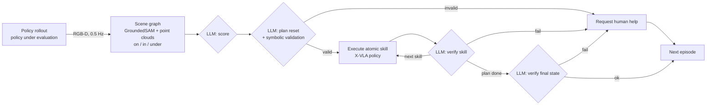

<div align="center">

# HALTER-Implementation

**An unofficial, open re-implementation of HALTER:**
**a graph-based harness for autonomous long-horizon manipulation evaluation and reset**

[](https://arxiv.org/abs/2609.19413)
[](https://www.python.org/)
[](LICENSE)
[](#status-and-roadmap)

English | [简体中文](README_zh.md)

</div>

> [!IMPORTANT]
> This repository is **not** affiliated with the authors of HALTER. It is a re-implementation based on the
> paper *From Rollout to Reset: A Graph-Based Harness for Autonomous Long-Horizon Manipulation Evaluation*
> ([arXiv:2609.19413](https://arxiv.org/abs/2609.19413)), written before any official code release.
> Details the paper leaves unspecified (prompts, geometric thresholds, task sub-goals, the role of the two
> policies per skill) are our own choices and are documented in [Differences from the paper](#differences-from-the-paper).

---

## Overview

Evaluating a manipulation policy on a real robot normally requires a person to reset the scene after every
rollout. For long-horizon tasks the problem is harder: a rollout can stop in a combinatorially large number of
terminal states, so a single learned reset policy cannot cover them.

HALTER addresses this with three ideas, all implemented here:

1. **Hierarchical reset.** A library of *atomic reset skills* (each a fine-tuned [X-VLA](https://arxiv.org/abs/2510.10274)
   policy) is sequenced by an LLM planner, so demonstration cost scales with the number of skills rather than
   the number of terminal states.
2. **3D scene graph as the state.** Task-relevant objects are segmented with GroundedSAM, lifted to per-object
   point clouds from RGB-D, and connected by geometric relations (`on`, `in`, `under`). The graph is tracked
   online at 0.5 Hz and keeps the last observation of occluded objects.
3. **LLM reasoning over the graph.** One LLM (Qwen3.5-397B in the paper) is prompted three ways, each with a
   few reference cases: **score** the rollout, **plan** the reset, and **verify** both each skill's effect and
   the final state. Any failed check triggers a request for human help.

## Pipeline



## Features

| Component | What is provided |
|---|---|
| Perception | OAK-D, ZED, RealSense and replay camera backends; GroundedSAM through HF `transformers`; multi-view point-cloud fusion with erosion, voxelization and outlier removal |
| Scene graph | Background tracking thread, occlusion memory, `on` / `in` / `under` inference, articulated-state estimation (e.g. drawer open/closed), container interior regions, fixed "home" regions, text serialization and graph diffs |
| Reasoning | Prompts for scoring, planning, per-skill verification and final verification; reference-case loader; symbolic plan validator with optional re-planning |
| LLM backends | `api` (Alibaba Cloud Model Studio / DashScope, or any OpenAI-compatible provider), `local_server` (self-hosted vLLM / SGLang), `local_hf` (in-process `transformers`), `mock` (rule-based oracle) |
| Skills | X-VLA skill executor on [LeRobot](https://github.com/huggingface/lerobot) with two policies per skill; skeleton for the motion-planning baseline (GraspNet + cuRobo) |
| Robots | Franka Panda + Robotiq 2F-85 (`franky`), LIBERO simulation wrapper, I2RT YAM interface skeleton |
| Evaluation | Closed-loop harness, human-intervention interface, metrics as in the paper (mean ± binomial standard error) |
| Simulation | Symbolic tabletop simulator that runs the whole loop without hardware or models |

## Installation

```bash
git clone https://github.com/gulucaptain/HALTER-Implementation.git
cd HALTER-Implementation
pip install -e .                                 # core: numpy, pyyaml, scipy, openai, pillow
```

Optional extras, installed as needed:

```bash
pip install -e ".[perception]"   # torch, transformers, camera SDKs (GroundedSAM, OAK-D, RealSense)
pip install -e ".[xvla]"         # lerobot[xvla] for skill training and execution
pip install -e ".[franka]"       # franky-control, pyRobotiqGripper
pip install -e ".[local_llm]"    # vllm>=0.17.0 for self-hosting Qwen
```

The ZED SDK (`pyzed`) and the YAM SDK (`i2rt`) are installed from their vendors.

## Quick start (no hardware, no model)

```bash
pip install -e ".[dev]"                             # pytest
pytest -q tests                                     # unit tests
python scripts/run_evaluation.py --config configs/sim.yaml
```

This runs 4 tasks × 25 episodes in the symbolic simulator with the rule-based oracle in place of the LLM, and
writes per-episode logs and `summary.json` to `runs/sim/`. Re-aggregate logs at any time with

```bash
python scripts/summarize.py runs/sim/*.jsonl
```

## LLM backends

All backends implement the same `chat(messages) -> str` interface and are selected by a YAML file in
`configs/llm/`.

### Hosted API (Alibaba Cloud Model Studio)

```bash
export DASHSCOPE_API_KEY=sk-...
python scripts/test_llm.py --llm configs/llm/api_dashscope.yaml        # compares the LLM to the oracle
python scripts/run_evaluation.py --config configs/sim.yaml --llm configs/llm/api_dashscope.yaml
```

Set `base_url` for your region (Beijing, Singapore or the workspace-specific domain) and confirm the model id
in the Model Studio console. Thinking mode is controlled by `enable_thinking` and is off by default.

### Self-hosted (vLLM)

```bash
bash scripts/serve_qwen_vllm.sh                     # Qwen/Qwen3.5-397B-A17B-FP8, TP=8, port 8000
python scripts/test_llm.py --llm configs/llm/local_vllm.yaml
```

The full model needs vLLM ≥ 0.17.0 and eight data-center GPUs (the vLLM recipe is verified on 8× H200).
`MODEL`, `TP` and `PORT` can be overridden as environment variables. For development on a single GPU, serve a
smaller Qwen model or use `configs/llm/local_hf_small.yaml`.

## Running on a real robot

1. **Calibrate cameras.** Save `T_world_cam` for each fixed camera and `T_ee_cam` for the wrist camera under
   `calib/`, then fill in the robot and camera entries of `configs/real_franka.yaml`.
2. **Describe the scene.** In `configs/scenes/<scene>.yaml`, set the table height, container interiors, home
   regions, articulation axes and relation thresholds for your setup.
3. **Train the skills.** Record 30–50 demonstrations per skill with `lerobot-record`, using the skill's
   instruction as the task string, then fine-tune two policies per skill:
   ```bash
   bash scripts/train_xvla_skill.sh <dataset_repo_id> drawer open_lower_drawer 0
   bash scripts/train_xvla_skill.sh <dataset_repo_id> drawer open_lower_drawer 1
   ```
4. **Collect reference cases.** The shipped cases are generated by the simulator and contain relations only.
   Replace them with graphs captured on your rig (1 success and 3 failures per task, 4 successes per skill):
   ```bash
   python scripts/capture_graph.py --config configs/real_franka.yaml \
       --task configs/tasks/drawer_store.yaml --out case.yaml
   ```
5. **Run the campaign.**
   ```bash
   python scripts/run_evaluation.py --config configs/real_franka.yaml
   ```
   The terminal prompts the operator whenever help is requested and, optionally, for a ground-truth label after
   each episode, which is used to compute scoring and verification accuracy.

## Repository structure

```
HALTER-Implementation/
├── halter/
│   ├── perception/      cameras, GroundedSAM segmenter, point-cloud utilities
│   ├── scene_graph/     online builder, relation inference, serialization
│   ├── llm/             LLM backends and JSON parsing
│   ├── reasoning/       prompts, reference cases, task/scene specs, scorer/planner/verifier
│   ├── skills/          skill library, X-VLA executor, motion-planning baseline
│   ├── robot/           Franka, YAM, LIBERO and null robots
│   ├── harness/         main loop, human interface, metrics
│   ├── sim/             symbolic simulator, LIBERO scene graphs
│   └── factory.py       builds a harness from YAML configs
├── configs/
│   ├── scenes/          drawer.yaml, kitchen.yaml (skill libraries, targets, thresholds)
│   ├── tasks/           4 main tasks + 3 held-out tasks
│   ├── llm/             api_dashscope, local_vllm, local_hf_small, mock
│   ├── reference_cases/ in-context examples per task and per skill
│   ├── sim.yaml         simulator campaign
│   └── real_franka.yaml real-robot campaign
├── scripts/             evaluation, LLM smoke test, vLLM serving, X-VLA training, case capture
└── tests/               unit and end-to-end tests
```

## Tasks and skills

Two scenes with six atomic reset skills each, as named in the paper:

| Scene | Tasks | Atomic reset skills |
|---|---|---|
| Drawer | Drawer-Store, Drawer-Retrieve | open / close the lower drawer; lemon from drawer → plate; lemon from table → plate; strawberry from plate → drawer; strawberry from table → drawer |
| Kitchen | Pot-Cook, Pan-Cook | pot lid back; stock pot from stove / table back; pan from stove / table back; carrot back in the sink |

Three held-out tasks (`configs/tasks/heldout_*.yaml`) reuse the same objects with new goals and the same skill
library, without additional training.

## Metrics

| Metric | Definition in this implementation |
|---|---|
| Reset SR | Fraction of episodes reset autonomously and confirmed correct by ground truth or the operator |
| Scoring accuracy | Fraction of episodes whose completed-subtask set matches ground truth |
| Verification accuracy | Fraction of per-skill and final verdicts that match ground truth |
| Plan validity | Fraction of episodes whose *first* plan passes symbolic validation |
| Interventions | Number of human-help requests; also reported as mean episodes between interventions |
| Operator time | Total time the operator spends resetting |

Rates are reported as mean ± binomial standard error, √(p(1−p)/n), which matches the uncertainties in the paper.

## Differences from the paper

- **Task definitions.** The paper names the tasks and skills but not their sub-goals or initial states. The
  sub-goals in `configs/tasks/` and the three held-out tasks are our reconstruction.
- **Two policies per skill.** The paper does not say how they differ or are combined. By default policy 0 runs
  first and policy 1 is used on a retry (`two_policy_mode: retry`); the training script gives them different
  seeds. `primary` and `alternate` modes are also available.
- **Failure handling.** As in the paper, a failed check requests human help (`skill_retries: 0`). Retries and
  re-planning can be enabled for ablations.
- **Plan validity.** Measured with a symbolic validator over skill preconditions and effects; the paper does
  not detail its protocol.
- **Prompts and thresholds.** Written from the paper's description; tune them on your setup.
- **Rollout policy.** The paper evaluates BESO checkpoints. Here any LeRobot policy can be rolled out.

## Status and roadmap

- [x] End-to-end loop in the symbolic simulator, with unit tests
- [x] Hosted-API and self-hosted Qwen backends
- [x] Perception, scene-graph and X-VLA skill modules for real hardware
- [ ] Validation on a physical Franka setup
- [ ] Reference cases captured from real scene graphs
- [ ] Full motion-planning baseline (GraspNet + cuRobo)
- [ ] YAM robot driver
- [ ] AutoEval baseline

Contributions and bug reports are welcome through issues and pull requests.

## Acknowledgements

This implementation builds on [X-VLA](https://arxiv.org/abs/2510.10274), [LeRobot](https://github.com/huggingface/lerobot),
[Grounding DINO](https://github.com/IDEA-Research/GroundingDINO), [Segment Anything](https://github.com/facebookresearch/segment-anything),
[vLLM](https://github.com/vllm-project/vllm), [Qwen](https://github.com/QwenLM) and [franky](https://github.com/TimSchneider42/franky).

## License

Released under the [MIT License](LICENSE). Third-party models and datasets keep their own licenses.
